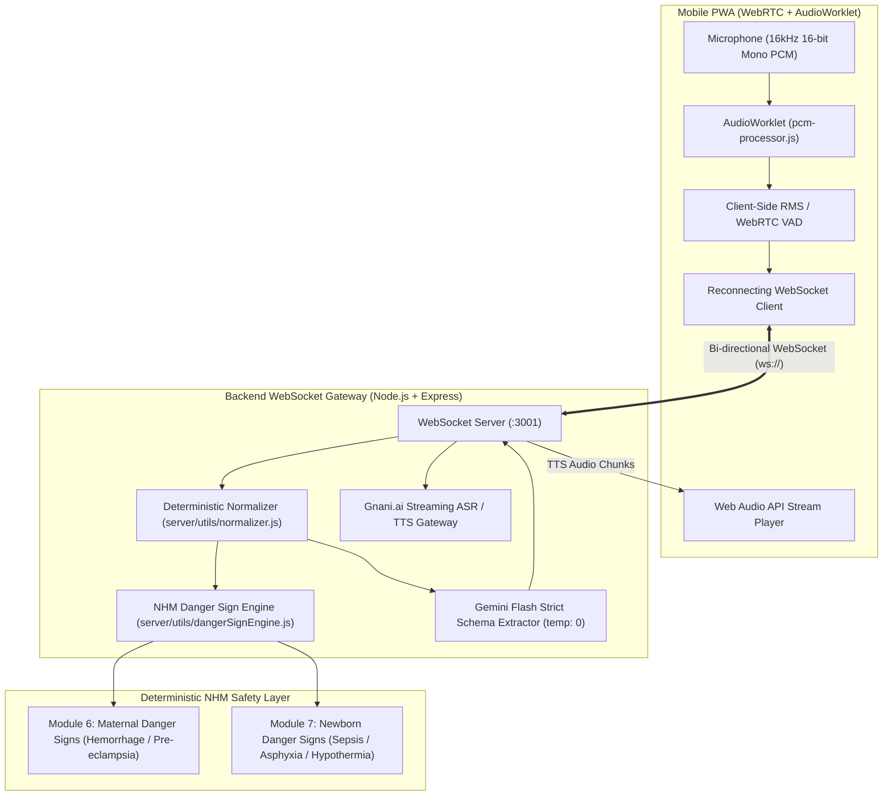

# 🩺 ASHA-Vaani (आशा-वाणी / ಆಶಾ-ವಾಣಿ)
### Zero-Touch, Full-Duplex Streaming Voice Field Register for Indian ASHA Workers
**BolBharat — Gnani Voice AI Innovation Challenge (Healthcare Track)**

[](https://asha-vaani.vercel.app)
[](https://nodejs.org)
[](https://react.dev)
[](https://nhm.gov.in)

ASHA-Vaani is a zero-touch, voice-driven clinical field register engineered for Accredited Social Health Activists (ASHAs) operating in loud, unstructured rural Indian environments. It transforms freeform, multilingual, code-mixed clinical dictation into structured National Health Mission (NHM) records in real time—with deterministic clinical danger sign escalation, sub-500ms Time-to-First-Audio (TTFA), and sub-100ms conversational barge-in audio flushing.

---

## 🏗️ System Architecture



---

## 🛡️ Deterministic NHM Clinical Safety Shield Rulebook

Missing a danger sign in maternal or newborn care incurs critical risk. ASHA-Vaani runs a **deterministic multilingual phonetic synonym matcher** across raw ASR transcripts and extracted symptoms—**never relying on LLM judgment alone**.

| Rule ID | NHM Module Citation | Target Condition | Multilingual Trigger Keywords (EN, HI, KN, TA, TE) | Mandatory Clinical Escalation Protocol |
| :--- | :--- | :--- | :--- | :--- |
| `MAT_BLEEDING` | **NHM Module 6**<br>*(Maternal Health)* | Antepartum / Postpartum Hemorrhage | `bleeding`, `spotting`, `hemorrhage`, `khoon`, `rakt`, `raktasrava`, `nettaru`, `irattam`, `rakta sraavam` | Flag `isHighRisk: true`, trigger high-contrast red alert card, prepend native-language PHC referral audio instruction. |
| `MAT_PREECLAMPSIA` | **NHM Module 6**<br>*(Maternal Health)* | Pre-eclampsia / Eclampsia / Convulsions | `severe headache`, `blurred vision`, `swelling`, `fits`, `convulsions`, `daura`, `sirdarad`, `tale novu`, `veekkam`, `talanoopulu` | Flag `isHighRisk: true`, advise emergency transport to 24x7 PHC/FRU. Zero treatment advice. |
| `NB_HIGH_FEVER` | **NHM Module 7**<br>*(Newborn Care)* | Neonatal Sepsis / Severe Hypothermia | `high fever`, `fever`, `hypothermia`, `cold body`, `bukhar`, `tez bukhar`, `thanda`, `jvara`, `jora`, `juram`, `kaichal` | Flag `isHighRisk: true`, instruct immediate Kangaroo Mother Care / warm transport to Sick Newborn Care Unit (SNCU). |
| `NB_BREATHING_FEEDING` | **NHM Module 7**<br>*(Newborn Care)* | Birth Asphyxia / Severe Acute Malnutrition | `difficulty breathing`, `chest indrawing`, `not feeding`, `unable to suck`, `unconscious`, `saans lena mushkil`, `doodh nahi peena`, `behosh` | Flag `isHighRisk: true`, immediate 108 ambulance dispatch, clear airway alert. |

---

## 📱 Three-Tier Adaptive Layout

- **Smartphone (`< 640px` — Single-Column Field View):**
  - Sticky compact header with language pills and connection status.
  - Above-the-fold **Voice Orb** with GPU-accelerated ripple rings and single-line live caption ticker.
  - Stacked clinical cards with container queries (`@container`).
  - Fixed bottom thumb dock with a **64px × 64px** primary mic button and quick barge-in interrupt controls.
- **Tablet (`640px – 1023px` — Two-Zone 60/40 Split):**
  - Left column (60%): Sticky Voice Stage (Orb, waveform, caption ticker, primary mic).
  - Right column (40%): Scrollable clinical data column (`RecordCard`, `DangerAlert`, `FollowUpQueue`).
  - **Slide-Over Judge Drawer:** Opens as a non-blocking right-side panel without interrupting live voice capture.
- **Desktop (`≥ 1024px` — Three-Pane Command Workspace):**
  - Three-column command layout (`1fr : 1.35fr : 1fr`).
  - Real-time Speech Telemetry (`VAD State`, `TTFA`, `Barge-In Status`, `WebRTC Noise Filter`).
  - Live 5-field `RecordCard` with container query reflow into a 2-column grid.
  - Follow-up action queue checklist + expanded Judge test drawer.

---

## ⚡ Quickstart & Local Setup

### Prerequisites
- Node.js 18+ (tested on Node 20 / 22 / 26)
- Modern browser (Chrome / Edge recommended for full Web Audio API and SpeechRecognition support)

### 1. Clone & Install Dependencies
```bash
git clone https://github.com/Sharan126/ASHA-VAANI.git
cd ASHA-VAANI

# Install all dependencies across client and server
npm run install:all
```

### 2. Configure Environment Variables
Copy `server/.env.example` to `server/.env`:
```bash
cp server/.env.example server/.env
```
Fill in your credentials (or run in built-in mock/fallback mode without keys):
```env
PORT=3001
GNANI_ASR_WS_URL=wss://asr.gnani.ai/v1/stream
GNANI_TTS_WS_URL=wss://tts.gnani.ai/v1/stream
GNANI_API_KEY=your_gnani_api_key_here
GEMINI_API_KEY=your_gemini_api_key_here
LLM_MODEL=gemini-1.5-flash-latest
NODE_ENV=development
```

### 3. Seed Synthetic Beneficiaries
```bash
npm run seed
```
Seeds 10 synthetic beneficiaries (`ID-101` to `ID-110`):
- `ID-101`: Lakshmi (Basavanahalli)
- `ID-102`: Meena (Chikkanahalli)
- `ID-103`: Priya (Doddaballapur)
- `ID-104`: Kavitha (Erananahalli)
- `ID-105`: Anita (Fattepur)
- `ID-106`: Sunita (Gulbarga Road)
- `ID-107`: Fatima (Hoskote)
- `ID-108`: Radha (Indiranagar Camp)
- `ID-109`: Pushpa (Jayanagar Cross)
- `ID-110`: Sarala (Kothanur)

### 4. Run Development Servers
```bash
# Start both server (:3001) and frontend dev server (:5173)
npm run dev

# Or run separately:
npm run dev:server   # Node.js Express + WebSocket on :3001
npm run dev:client   # Vite React PWA on :5173
```

Open **`http://localhost:5173`** or **`http://localhost:3001`** in your browser.

---

## 🧪 Judge Live-Test Scenarios

Expand the **Judge Quick-Test Scripts** drawer in the UI and tap **Run Test** on any scenario:

1. **Scenario 1: Code-Mixed ANC Visit (Kannada + Hindi + English)**
   - *Prompt:* `"Lakshmi ka ID ek sau ek hai. ANC visit. Weight teen point do kilo. TT injection due. Next visit pandrah din baad."`
   - *Expected Result:* Auto-resolves `beneficiary_id: "ID-101"`, `visit_type: "ANC"`, `weight_kg: 3.2`, `vaccinations_due: ["TT Injection"]`, and schedules next visit date.
2. **Scenario 2: Full-Duplex Barge-In Weight Correction**
   - *Prompt:* `"Nahi, weight galat hai. Correct weight do point aath kilo hai."`
   - *Expected Result:* Immediate barge-in audio flush (<100ms), selectively updates `weight_kg: 2.8` with visual amber diff highlight (`✓ Updated`) while preserving all other fields.
3. **Scenario 3: Newborn Danger Sign Escalation (NHM Module 7)**
   - *Prompt:* `"ID-105 ke newborn ko tez bukhar hai aur saans lene mein takleef ho rahi hai. Doodh bhi nahi pee raha."`
   - *Expected Result:* Immediate `HIGH_RISK_PHC` flag, high-contrast red alert banner, and audio instruction: *"Danger sign detected. Refer to Primary Health Centre immediately."*

---

## 📄 License
MIT License. Built for the **BolBharat — Gnani Voice AI Innovation Challenge**.
